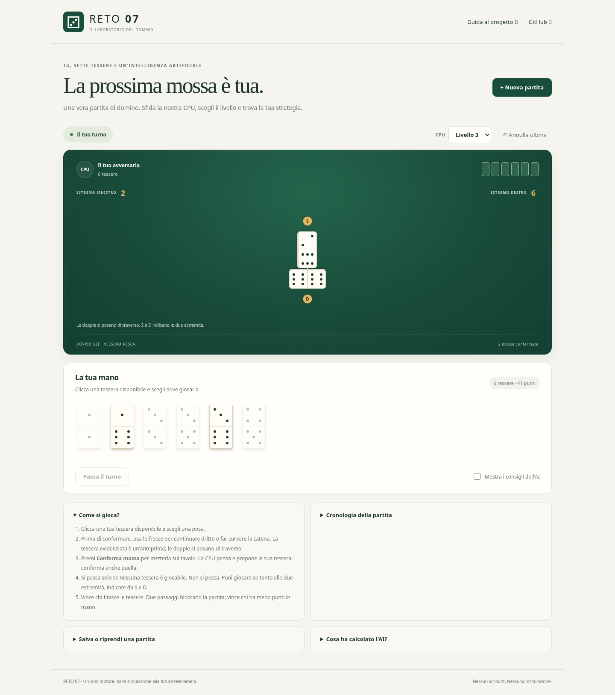
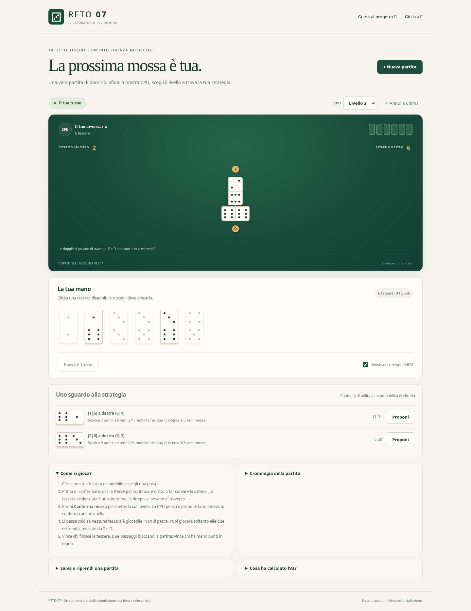
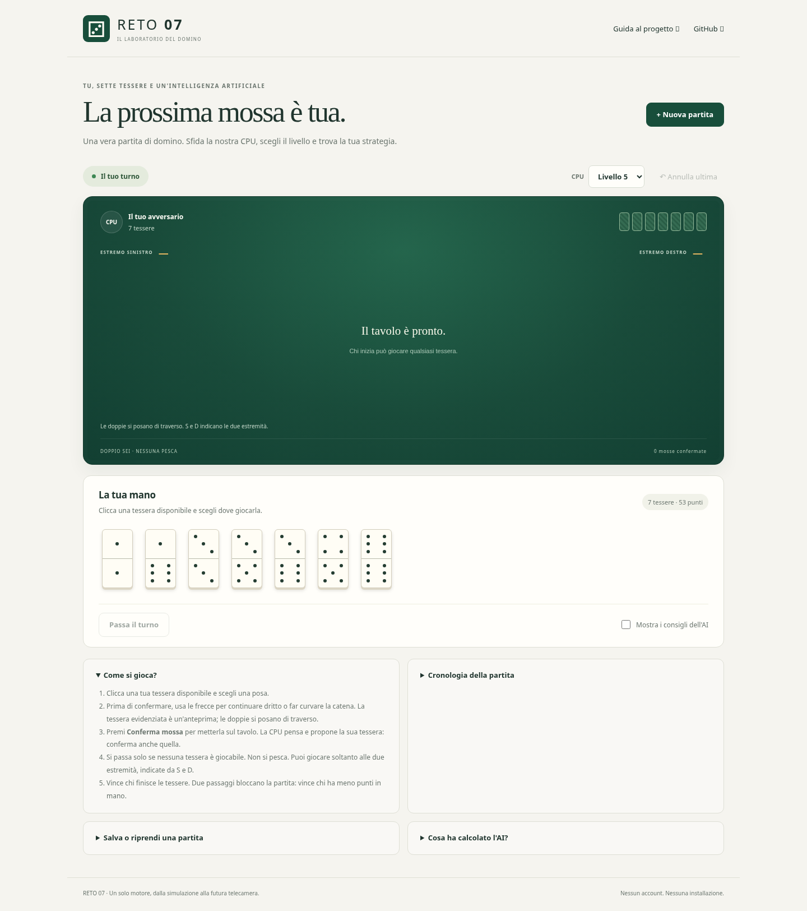
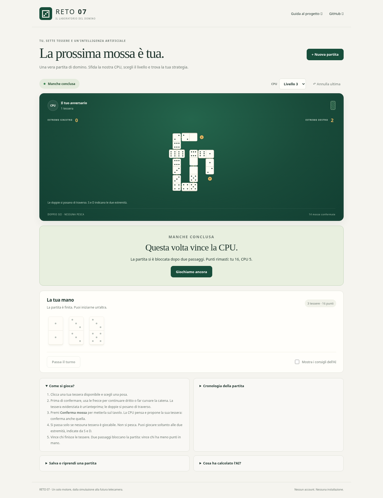

# Screenshot autentici per la presentazione

Acquisizione: **6 novembre 2026, 12:47–12:48, Europe/Madrid**
(11:47–11:48 UTC). Le nove immagini sono PNG integrali prodotti da Playwright
eseguendo davvero Chromium **154.0.8037.57**, in modalità headless Linux,
viewport 1440×1100, scala 1. L'altezza del PNG varia per includere tutta la pagina.
Non sono stati ritoccati pixel, sostituiti elementi DOM o simulati risultati.

**Sorgente di tutte le immagini:** build locale dell'applicazione browser
accettata, tag `consegna-v1.0`, commit
`53b349bc82db48d44deeeed7df5d2c760755b787`.
Il checkout di partenza è `9f3348b4d09dfcaad64dfbe8a17f21465bb783bd`, che aggiunge
soltanto il precedente materiale di passaggio. Tutti i 133 file della consegna,
compresi motore, regole, strategia, frontend e script, sono stati confrontati
byte per byte prima e dopo l'acquisizione: nessuna differenza.

Il Python del motore gira realmente nel Web Worker tramite Pyodide 0.27.7.
Il trasporto del CDN usa il trust store verificato di Python, come nei collaudi
browser esistenti; TLS non è stato disabilitato. Il server temporaneo di prova
è stato chiuso dal programma di acquisizione. Queste non sono catture del sito
pubblico o dell'integrazione fisica.

## Contesto della partita

Tutte le immagini usano **seed 43**. La partita è giocata al **livello 3**;
prima di effettuare mosse sono selezionati e acquisiti i livelli 1–5, poi viene
ripristinato il livello 3. Cambiare livello non distribuisce nuove tessere.

I clic della parte umana sono automatizzati: viene scelta la tessera legale
con somma maggiore, senza leggere la mano avversaria e senza seguire il consiglio
AI. La CPU usa lo `StrategyEngine` consegnato. Le pose e i passaggi sono confermati
tramite i pulsanti originali. Quando disponibile viene scelta una direzione
verticale tramite le frecce dell'app, così si vedono curve e doppie trasversali.
La sequenza completa degli eventi è nella provenienza; non è un torneo di forza.

Ogni PNG ha un JSON omonimo con contesto, istante UTC e snapshot pubblico
effettivo della partita. [PROVENIENZA.json](PROVENIENZA.json) conserva hash
SHA-256 di immagini, snapshot, script di acquisizione e sorgenti accettati,
versioni degli strumenti, manifest della build, azioni e risultato finale.

## 1. Partita iniziale

[01-mano-iniziale.png](01-mano-iniziale.png) — livello 3, zero eventi, tavolo
vuoto, sette tessere proprie visibili e sette avversarie coperte. I consigli
sono disattivati, come nell'avvio normale.


## 2. Partita in corso

[02-partita-in-corso.png](02-partita-in-corso.png) — livello 3, due pose
confermate, due tessere nella catena, estremi logici **2 e 6**, sei tessere
proprie e sei avversarie. Nessuna proposta è pendente: il tavolo mostra solo
tessere già confermate. La doppia 6–6 è trasversale.



## 3. Classifica e suggerimento AI

[03-classifica-consiglio-ai.png](03-classifica-consiglio-ai.png) — stesso stato
con due eventi; è attivato il checkbox originale **Mostra i consigli dell'AI**.
La classifica include entrambe le mosse legali: prima **1–6 a destra**, utilità
11,91; seconda **3–6 a destra**, utilità 5,50. Sono mostrate le spiegazioni e
la profondità completata 3/3. La prima riga è il suggerimento del motore.
Le utilità non sono probabilità di vittoria; i tempi possono variare fra macchine.



## Cinque livelli

Cinque screenshot separati dell'app invariata, con il selettore originale
impostato su ciascun valore; non è un montaggio di un menu. Tutte le catture
sono precedenti alla prima posa: sette tessere per giocatore e zero eventi.
La partita successiva usa il livello 3. Queste catture documentano la selezione;
le ricerche di ciascun livello sono verificate nei test del motore/bridge.

| Immagine | Valore selezionato | Profondità massima configurata |
|---|---|---|
| [04-livello-1.png](04-livello-1.png) | Livello 1 | Una semimossa |
| [04-livello-2.png](04-livello-2.png) | Livello 2 | Due semimosse |
| [04-livello-3.png](04-livello-3.png) | Livello 3 | Tre semimosse |
| [04-livello-4.png](04-livello-4.png) | Livello 4 | Quattro semimosse |
| [04-livello-5.png](04-livello-5.png) | Livello 5 | Cinque semimosse |



## 5. Fine della stessa partita

[05-fine-partita.png](05-fine-partita.png) — livello 3, **14 eventi confermati**,
di cui dieci pose e quattro passaggi. Gli ultimi due passaggi consecutivi
bloccano la partita. Restano tre tessere proprie e una avversaria; **vince la
CPU con 5 punti residui contro 16**. È il risultato effettivo del simulatore,
non una schermata di vittoria costruita. La mano CPU rimane coperta.



## Come riprodurre l'acquisizione

Dalla radice del repository, con Python 3.10+, Playwright e Chromium disponibili:

```sh
python docs/demo-professore/capture_demo.py --environment-tls --output local_runs/demo-professore-riproduzione
```

Il programma usa `scripts/build_web.py` e le funzioni di interazione dei test
browser consegnati, avvia internamente un server temporaneo e lo chiude alla fine.
Il CDN Pyodide richiede rete al primo caricamento. `--environment-tls` usa il
trasporto HTTPS verificato dell'ambiente; può essere omesso su un sistema con
trust store browser già funzionante. Per un altro Chromium specificare
`--chromium PERCORSO_ESEGUIBILE`.

Scegliere una directory di output nuova: lo script rifiuta di sovrascrivere le
evidenze precedenti. L'applicazione non viene modificata per l'acquisizione.
Differenze di font, versione del browser e misure temporali possono cambiare
i pixel della riproduzione senza modificare la partita.

## Ambito e verifiche

La demo ha concluso una partita nel browser e prodotto nove screenshot con
zero errori pagina/console. Sono inoltre passati gli otto test esistenti del
bridge, senza skip. [VERIFICA_MATERIALE.json](VERIFICA_MATERIALE.json) distingue
queste prove dai risultati storici letti dai CSV, senza dichiarare rieseguiti
i tornei. La suite completa storica 48/48 e le 6.000 partite sono riportate
con le rispettive fonti nella [scheda per il professore](../../DEMO_PROFESSORE.md).

**OpenCV fisico: NOT_RUN.** Nessuna camera o file locale Windows è stato usato.
Restano necessari adattatore visivo, tracker fisico e collaudo sul PC; non
dedurre un'integrazione camera funzionante dalle immagini del simulatore.
